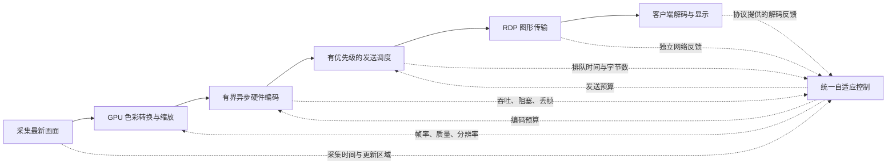

# SwiftRDP 实时桌面传输设计

目标是在经过验证的分辨率、硬件和链路条件下，同时提供清晰画面、稳定 60 fps 和低输入延迟。配置帧率代表体验目标；系统应测量整条链路，识别真实瓶颈并主动减少工作量。

## 数据与反馈链路

RDP FRAME_ACK 确认的是解码进度，不等于屏幕实际呈现时间。标准 mstsc 的反馈粒度也不同于 WebRTC 的逐包到达反馈；控制策略必须使用实际获得的信息。

## 实现原则

| 环节 | 设计 |
| --- | --- |
| 采集 | 无变化时减少工作；受阻时只保留最新的待编码画面。 |
| 图像处理 | 尽量保留 IOSurface/CVPixelBuffer，在 GPU 上转换色彩、缩放，避免每帧复制整张图片到 CPU 字节数组。 |
| 编码 | 使用硬件低延迟模式，避免重排和前视。用最小足够深度的异步流水线，从两帧起测；用持续输出吞吐和实际阻塞判断容量。 |
| 额度 | 编码在途量、已发送未确认量和本地排队量分别有明确上限，遵守客户端协议额度；扩大缓冲不是提升吞吐的替代方案。 |
| 顺序 | 并发编码后仍保证码流顺序、关键帧隔离和代际重置正确。优先淘汰未编码旧画面；已编码参考帧不能随意丢弃。 |
| 发送 | 编码平均码率与发送节奏分别控制。限制视频突发和排队，保护输入、控制与音频；文件传输不占满交互通道。 |
| 网络 | 使用独立 RTT、传输背压及协议反馈；媒体发送量低不代表链路容量低，空队列也不证明可以无限提高码率。 |
| 客户端 | 在可控制的客户端上使用硬件解码和低等待显示路径，避免额外的渲染队列。 |

单帧提交到结果返回的延迟不能直接替代流水线吞吐。编码流水线深度可用目标帧率与实际延迟估算起点，再测量是否真正提高吞吐、是否增加排队。两帧不是固定的最优值；编码器没有足够处理能力时，多排帧不会产生更多能力。

## 内容质量与退化策略

文字、代码和静态界面需要高保真与清晰边缘；运动、滚动和视频需要稳定更新。采用变化区域、内容分类和停止运动后的清晰度恢复，避免所有场景永久采用同一种取舍。按协议与双方硬件能力选择编码和色彩格式；文字场景关注 4:4:4 的收益与额外成本。

出现压力时先定位网络、编码、解码或呈现瓶颈。针对网络压力调整码率与质量；针对像素处理能力不足减少像素工作量或选择合适编码模式。动态场景优先维持可用的交互帧率，必要时降低质量或分辨率；静态内容保留精细显示。帧率降低应由真实能力与质量底线决定，并有明确恢复机制。

保持 mstsc 时，编码、通道和反馈遵守 RDP 能力协商。UDP2 图形通道可以减轻与主 TCP 控制通道的相互阻塞，但可靠有序传输仍有重传等待。更自由的媒体传输、反馈和编码方案需要对应客户端与协议支持。

## 验证与改造顺序

1. 同分辨率、同画面、同码率测量硬件编码的持续吞吐、帧大小和延迟分布，对比一帧与有限多帧在途。
2. 两帧有界异步编码、顺序保护和按持续繁忙完成间隔调控 FPS 已实现；继续用真实链路验证吞吐与延迟。
3. 测量并优化 GPU 处理、帧额度、发送排队和反馈控制。
4. 优化文字与运动场景的编码质量，再评估额外编码模式与传输能力。

每一步同时验收文字清晰度、稳定帧率、帧间隔 P95/P99、输入到画面响应、队列年龄、CPU/GPU 和内存开销。FRAME_ACK 数据仅作为解码观测；显示与输入到画面的延迟需要客户端遥测或独立端到端测量。

场景至少包括持续文字滚动、窗口拖动、视频播放、静止后恢复、缩放和分辨率切换；网络包含足够带宽、带宽骤降后恢复、RTT/抖动变化及丢包。目标是在有能力的条件下达到持续 60 fps，在不足时及时退化并恢复，避免长期停在低帧率或积压旧画面。

参考：[Apple 低延迟编码](https://developer.apple.com/videos/play/wwdc2021/10158/)、[Microsoft RDP 图形编码](https://learn.microsoft.com/en-us/azure/virtual-desktop/graphics-encoding)、[WebRTC 发送调度](https://webrtc.googlesource.com/src/+/refs/heads/main/modules/pacing/g3doc/index.md)、[Google 拥塞控制实现](https://webrtc.googlesource.com/src/+/refs/heads/main/modules/congestion_controller/goog_cc/goog_cc_network_control.cc)、[RFC 8836](https://www.rfc-editor.org/rfc/rfc8836.html)。
